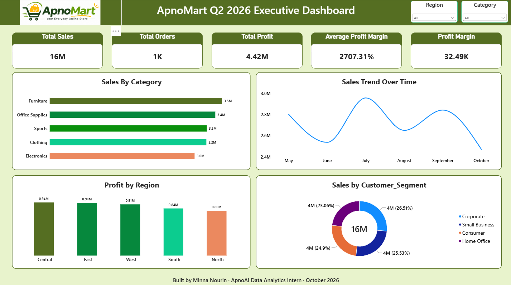

# 📊 ApnoMart Q2 2026 — Executive Business Intelligence Dashboard

**Created by:** Minna Nourin
**Role:** ApnoAI Data Analytics Intern  
**Tool:** Microsoft Power BI  
**Dataset:** ApnoMart Sales Dataset (1,200 Records)  
**Data Coverage:** May–October 2026

## 📌 Project Overview

This project focuses on analyzing ApnoMart's e-commerce sales data to identify revenue trends, profitability patterns, regional performance, and customer behavior.

An interactive Power BI dashboard was developed to transform raw sales data into meaningful business insights and strategic recommendations for management.

## 📈 Dashboard Preview

## 🎯 Dashboard Features

- Total Sales, Total Profit, Total Orders and Profit Margin KPIs.
- Sales by Category analysis.
- Monthly Sales Trend.
- Profit by Region.
- Sales by Customer Segment.
- Interactive Region and Category filters.
- Business insights and strategic recommendations.

## 💡 Key Business Insights

**1. Revenue Pattern**

Furniture is the highest revenue-generating category, contributing ₹35.18 lakh (21.63%) of total sales.

**2. Profitability Pattern**

Office Supplies has the highest category profit margin at 34.80%, while Electronics has the lowest at 18.88%.

**3. Customer Behavior**

Corporate customers contribute the highest segment revenue at ₹43.11 lakh (26.51%). Cash is the largest payment method by sales value at ₹35.74 lakh (21.98%).

## 🚀 Strategic Recommendation

Improve Electronics profitability through pricing and discount reviews, strengthen high-margin Office Supplies sales, develop targeted Corporate customer offers, and investigate the October sales decline.

## 🛠️ Tools & Technologies

- Microsoft Power BI
- Power Query
- DAX (Data Analysis Expressions)
- Microsoft Excel / CSV
- GitHub

## 📂 Project Files

| File | Description |
|---|---|
| dashboard.png | Executive dashboard screenshot |
| insights.pdf | Strategic business insights report |
| apnomart.pbix | Power BI source project |

## 📊 Project Objective

To demonstrate practical Business Intelligence skills, including data analysis, KPI development, interactive visualization, insight generation, and business decision-making.

---

**Built by Minna Nourin**  
ApnoAI Data Analytics Internship 
